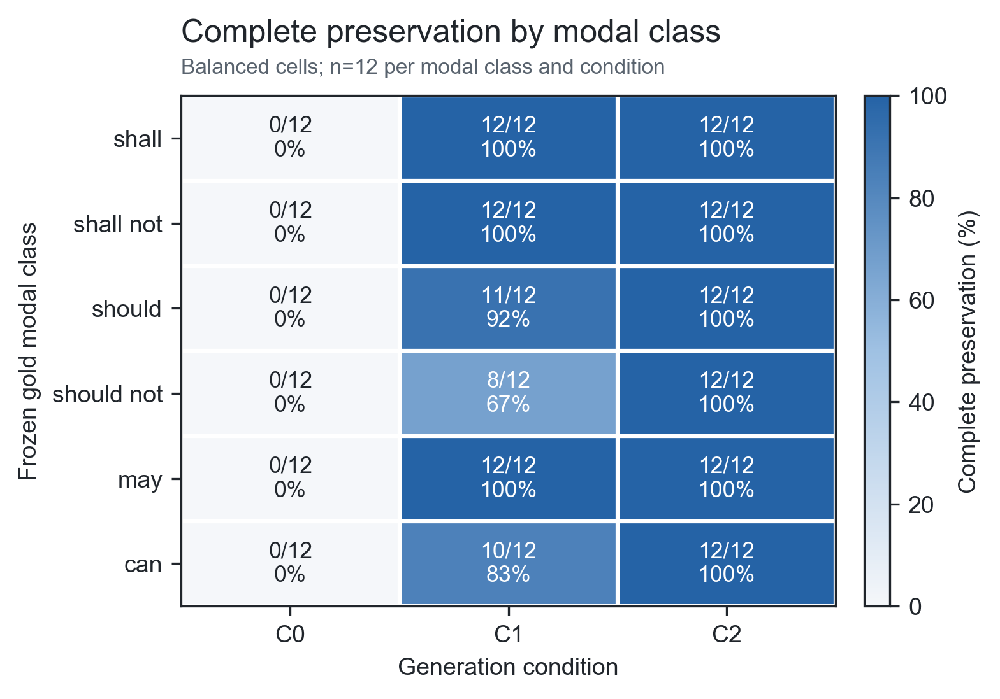

# 3GPP 요구사항의 한국어 설명에서 규범적 의미 보존을 위한 증거 제약 생성 평가

**Evaluating Evidence-Constrained Generation for Preserving Normative Meaning in Korean Explanations of 3GPP Requirements**

**저자:** [저자명] · **소속:** [소속] · **이메일:** [이메일]

## 요약

3GPP 기술규격에서 *shall*, *should*, *may*, *can* 등의 조동사는 각각 의무, 권고, 허용, 가능·능력처럼 서로 다른 규범적 의미를 나타낸다. 따라서 대규모 언어 모델이 영문 규격을 한국어로 설명할 때 관련 내용을 대체로 언급하더라도 의무 강도, 부정, 행위자, 적용 조건 또는 예외를 바꾸면 기술적 의미가 달라질 수 있다. 본 연구는 ETSI가 배포한 3GPP TS 23.501 및 TS 24.501 V18.12.0 Release 18에서 6개 조동사 범주별 12개씩 총 72개 문장을 구축하고, 동일 모델에서 세 생성 조건을 비교하였다. C0는 질문만, C1은 질문과 정답 원문 조항, C2는 C1 입력에 원문으로부터 구조화한 Evidence Constraint를 제공하였다. 완전 의미 보존율은 C0 0.00%, C1 90.28%, C2 100.00%였다. C1 대비 C2의 paired 차이는 +9.72%p(bootstrap 95% CI: +2.78~+16.67%p, exact McNemar *p*=0.015625)였으며, C1의 실패 7건 중 4건은 *should not*의 권고 강도를 보존하지 못한 사례였다. 이 결과는 원문을 단순 제공하는 것에 더해 규범 요소를 명시적으로 구조화하는 방식이 한국어 설명의 의미 보존에 기여할 가능성을 보여준다. 다만 본 실험은 oracle evidence가 주어진 단일 모델·고정 문서·72개 사례의 ceiling 평가이며, 동일 평가자의 지연 재평가와 판정을 사용했으므로 검색 성능이나 일반적인 완전 성능, 독립 전문가 타당성을 입증하지 않는다.

**키워드:** 3GPP, 대규모 언어 모델, 규범 언어, 의미 보존, 증거 제약, 한국어 기술 설명

## 1. 서론

3GPP 기술규격은 이동통신 시스템의 구조와 프로토콜 동작을 정의하며, 구현자가 따라야 할 요구사항을 정교한 규범 언어로 표현한다. ETSI 작성 규칙에서 *shall/shall not*은 의무·금지, *should/should not*은 권고·비권고, *may*는 허용, *can*은 가능 또는 능력을 뜻한다[1]. 특히 *may*와 *can*은 한국어에서 모두 “~할 수 있다”로 번역되기 쉬우나, 전자는 표준이 부여한 허용이고 후자는 기술적 가능성이라는 차이가 있다. 또한 3GPP 규격은 영어로 작성되므로[2], 한국어 설명을 생성하는 과정에서 이러한 구분이 흐려지면 구현 또는 시험 판단이 달라질 수 있다.

기존 연구는 3GPP 문서 데이터셋과 질의응답 성능[3], 검색증강생성(RAG)의 정확성·검증 가능성[4], 한국어 통신 에이전트의 종합 역량[5], 교차 참조와 규격 버전 변화의 검색[6], 규범 언어를 포함한 보안 추론[7]을 다뤘다. 그러나 확인한 범위에서 영문 3GPP 문장을 한국어로 설명하는 과정의 규범 의미 보존을 조동사 강도뿐 아니라 행위자·조건·행동·예외까지 분해하고, 동일 사례에서 입력 구조의 효과를 paired 방식으로 측정한 연구는 발견하지 못했다.

이에 본 연구는 다음 질문을 다룬다. **정답 원문을 제공한 생성(C1)에 비해, 원문에서 추출한 규범 요소를 구조화해 함께 제공하는 생성(C2)이 한국어 설명의 완전 의미 보존율을 높이는가?** 본 연구의 기여는 (1) 3GPP 규범 문장의 한국어 설명 오류를 여섯 의미 요소로 분해한 평가 기준, (2) 질문만 제공하는 기준선과 동일 oracle evidence를 공유하는 두 조건의 통제 비교, (3) 조동사 범주별 오류 및 민감도 분석이다. RAG 자체나 검색 정확도는 본 연구의 기여 범위에 포함하지 않는다.

## 2. 관련 연구와 연구 경계

TSpec-LLM은 Release 8~19의 3GPP 문서를 포함하는 공개 데이터셋과 naive RAG 평가를 제시했고, 여러 범용 모델의 질의응답 정확도가 RAG 사용 시 향상됨을 보고하였다[3]. TelecomRAG와 Telco-RAG는 통신 규격에 적합한 검색·생성 파이프라인과 답변의 정확성 및 검증 가능성을 다뤘다[4], [8]. DeepSpecs는 조항 정렬 인덱스, 버전 차이, Change Request를 결합하여 교차 참조와 규격 변화를 추적한다[6]. 이러한 연구는 “관련 근거를 어떻게 찾을 것인가”에 주로 답한다.

TelAgentBench는 한국어 통신 서비스 맥락에서 reasoning, planning, action, RAG, instruction following을 포함한 1,700개 이상의 에이전트 사례를 평가한다[5]. CellularSpecSec-Bench는 3GPP의 규범 언어, 교차 참조 및 표·그림 근거를 포함하는 보안 해석 문제를 다룬다[7]. 본 연구는 이들과 달리 에이전트의 종합 성능이나 보안 추론을 평가하지 않는다. 검색 오류를 제거한 동일 원문 조건에서 영어 규범 구조가 한국어 자연어 설명에 보존되는지만 좁게 측정한다. 따라서 본 연구의 차별성은 새로운 통신 RAG 구조가 아니라 **교차언어 규범 충실도라는 평가 대상과 Evidence Constraint의 통제 효과**에 있다.

## 3. 연구 방법

### 3.1 데이터셋

실험 원문은 ETSI 공식 배포본인 3GPP TS 23.501 V18.12.0 Release 18과 TS 24.501 V18.12.0 Release 18로 고정하였다[9], [10]. 문서 파일의 버전, URL 및 SHA-256을 수집 시점에 기록했다. 조항 4~8(TS 23.501)과 조항 4~6(TS 24.501)에서 규칙 기반으로 추출한 7,727개 후보를 출발점으로 하여, 목차·머리말·표/그림 의존 문장·외부 인용·파싱 손상·행위자가 불명확한 문장·중복 및 근접 중복을 제외하였다.

최종 데이터는 *shall*, *shall not*, *should*, *should not*, *may*, *can*의 6개 범주에서 각각 12개씩 총 72개 사례로 구성했다. 두 규격에서 각각 36개를 사용했고, 난도는 단순 8개, 조건형 22개, 복합형 42개였다. 각 사례에는 원문, 규격·버전·조항, 한국어 질문과 함께 actor, modal class, polarity, condition, action, exception을 원문에 근거해 라벨링하였다. 질문은 정답 조동사 범주를 직접 노출하지 않도록 작성했다. 파일 선택과 난도 규칙은 모델 실행 전에 동결했으며, pilot 18개는 프롬프트 수정에만 사용하고 본 결과에서 제외했다.

### 3.2 실험 조건

세 조건은 같은 질문과 출력 스키마를 사용하였다.

- **C0 (question only):** 한국어 질문과 규격 메타데이터만 제공하고 6개 규범 유형 중 하나를 선택하도록 강제한 폐쇄형 기준선이다.
- **C1 (raw evidence):** C0 입력에 정답 영문 원문 조항을 추가한다.
- **C2 (evidence constraint):** C1과 동일한 원문에 actor, modal type, polarity, condition, action, exception 및 citation을 구조화한 Evidence Constraint를 추가한다.

C1과 C2는 완전히 같은 원문을 받으므로 둘의 차이는 검색 성공 여부가 아니라 증거 표현 구조다. OpenAI Responses API의 `gpt-5.4-mini-2026-03-17` 스냅샷을 사용했고, temperature 0, reasoning effort none, 최대 출력 600 tokens로 고정하였다. 72개 사례×3조건의 216개 요청 순서는 사전 고정 seed로 섞었다. 216개 요청과 JSON 파싱이 모두 성공했으며, 의미 오류를 이유로 응답을 재실행하지 않았다.

### 3.3 평가 방법

주 지표인 **완전 의미 보존(complete preservation)**은 적용 가능한 actor, modal force, polarity, condition, action, exception을 모두 보존하고 원문에 없는 주요 규범 주장을 추가하지 않은 경우에만 1로 판정하였다. 하나라도 누락·변형되면 0이다. 보조 지표로 modal class accuracy, unsupported addition rate, citation exactness를 사용했다. 자연어 설명이 JSON의 구조화 필드와 충돌하면 자연어 설명을 기준으로 실패 처리했다.

응답은 조건과 사례 식별자를 가린 상태에서 1차 평가하고, 순서를 다시 섞어 지연 2차 평가한 뒤 불일치를 판정하였다. 완전 보존에 대한 동일 평가자 일치도는 213/216(98.61%, Cohen's κ=0.970), 적용 가능한 전체 이진 판정의 일치도는 1,322/1,348(98.07%, κ=0.955)이었다. 이는 동일 평가자의 반복 일치도이며 독립 평가자 간 신뢰도가 아니다. 조건별 비율에는 Wilson 95% 신뢰구간을, paired 차이에는 고정 seed의 20,000회 paired bootstrap 신뢰구간과 양측 exact McNemar 검정을 사용하였다.

## 4. 결과 및 분석

### 4.1 구조화된 제약은 C1의 잔여 의미 오류 7건을 제거했다

표 1에서 C0의 완전 보존은 0/72였고 원문에 없는 규범 추가는 65/72였다. 원문을 제공한 C1은 완전 보존이 65/72(90.28%)로 크게 높아졌고, 구조화된 Evidence Constraint를 추가한 C2는 72/72(100.00%)였다. C1 대비 C2의 완전 보존 차이는 +9.72%p였으며, paired bootstrap 95% 신뢰구간은 +2.78~+16.67%p였다. 두 조건에서 C1만 성공한 사례는 없고 C2만 성공한 사례는 7개로, exact McNemar 검정 결과는 *p*=0.015625였다.

**표 1. 조건별 규범 의미 보존 결과(조건별 n=72)**

| 조건 | Modal 정확도 | 완전 의미 보존 | 미지원 추가 | 정확 인용 |
|---|---:|---:|---:|---:|
| C0 | 15/72 (20.83%) | 0/72 (0.00%) | 65/72 (90.28%) | 해당 없음 |
| C1 | 56/72 (77.78%) | 65/72 (90.28%) | 7/72 (9.72%) | 72/72 (100.00%) |
| C2 | 72/72 (100.00%) | 72/72 (100.00%) | 0/72 (0.00%) | 72/72 (100.00%) |

C0와 C1의 차이는 근거 제공의 효과와 조건별 프롬프트 차이를 함께 포함하므로, 주 결론은 동일 원문을 공유하는 C1-C2 비교에 둔다. 또한 C2의 72/72는 현재 표본에서 오류가 관찰되지 않았다는 뜻이지, 모집단 오류율이 0이거나 다른 모델·Release·검색 결과에서도 완전하다는 뜻은 아니다.

### 4.2 C1 오류는 *should not*과 의미 범위가 복잡한 문장에 집중됐다

그림 1은 조동사별 완전 보존을 보여준다. C1은 *shall*, *shall not*, *may*에서 각각 12/12를 보존했지만, *should* 11/12, *should not* 8/12, *can* 10/12였다. C1의 7개 실패 중 *should not* 4건은 비권고를 다른 강도로 표현하면서 modal force를 보존하지 못했다. 나머지 3건은 actor·force·action이 함께 어긋났고 원문에 없는 규범 내용을 추가했다. 이는 단순 원문 제공만으로 높은 전체 정확도를 얻더라도 약한 규범 강도와 복합 의미 범위에서 잔여 오류가 남을 수 있음을 시사한다.

**그림 1. 조동사 범주별 완전 의미 보존율.** 각 셀은 성공 수/12와 비율을 나타낸다. 범주별 차이는 표본이 작으므로 탐색적으로 해석한다.

세 실패 사례(`MAIN-CAN-004`, `MAIN-SD-002`, `MAIN-CAN-008`)는 모델 실행 전에 modal이 포함된 종속 표현의 행위자와 범위가 모호할 수 있다고 지정하였다. 이들을 제외한 민감도 분석에서도 C1은 65/69(94.20%), C2는 69/69(100.00%)였다. 따라서 주 결과의 방향은 유지됐지만 차이는 +5.80%p로 감소한다. 독립 통신 전문가가 이 세 사례의 gold scope를 검토하기 전에는 1차 효과 크기만으로 강한 일반화를 해서는 안 된다.

## 5. 결론 및 한계

본 연구는 3GPP 영문 규범 문장을 한국어로 설명하는 과제에서 정답 원문만 제공한 C1보다, 원문의 actor·modal·polarity·condition·action·exception을 명시한 C2가 완전 의미 보존율을 90.28%에서 100.00%로 높였음을 관찰하였다. 특히 C1의 오류가 *should not*과 의미 범위가 복잡한 일부 문장에 집중됐다는 점은, 통신 규격 설명 시스템이 일반적인 “근거 있음” 여부를 넘어 규범 강도와 적용 범위를 별도로 검증할 필요가 있음을 보여준다.

그러나 본 결과에는 다섯 가지 한계가 있다. 첫째, 정답 원문을 직접 제공했으므로 검색이나 end-to-end RAG 성능을 평가하지 않았다. 둘째, 단일 모델 스냅샷과 두 규격의 한 버전, 72개 사례에 한정된다. 셋째, 데이터 라벨·두 번의 평가·불일치 판정을 동일 평가자가 수행했으므로 독립 전문가 타당도가 없다. 넷째, 세 사례에는 사전 지정된 gold-scope 모호성이 있다. 다섯째, C2 입력은 사람이 구축한 정답 구조이므로 실제 시스템에서 자동 추출할 때 발생할 오류를 포함하지 않는다.

후속 연구에서는 (1) 통신 전문가 2인 이상의 독립 라벨·평가, (2) 다른 모델과 Release에서의 재현, (3) 자동 Evidence Constraint 추출 정확도 측정, (4) 검색 실패를 포함한 end-to-end 파이프라인 평가를 순차적으로 수행할 필요가 있다. 따라서 현 단계의 결론은 “구조화 제약이 일반적인 3GPP 질의응답을 해결한다”가 아니라, **고정된 정답 증거 조건에서 규범 구조를 명시한 입력이 한국어 설명의 의미 보존을 개선할 가능성이 확인됐다**는 범위로 제한한다.

## 참고문헌

[1] ETSI, “ETSI Drafting Rules,” Clause 3.2, *Verbal forms for the expression of provisions*, 2026. [Online]. Available: https://portal.etsi.org/Services/editHelp/How-to-start/ETSI-Drafting-Rules

[2] 3GPP, “Third Generation Partnership Project Working Procedures,” Article 56, *Working language*, 2024. [Online]. Available: https://www.3gpp.org/ftp/information/working_procedures/3gpp_wp.pdf

[3] R. Nikbakht, M. Benzaghta, and G. Geraci, “TSpec-LLM: An Open-source Dataset for LLM Understanding of 3GPP Specifications,” arXiv:2406.01768, 2024.

[4] G. M. Yilma, J. A. Ayala-Romero, A. Garcia-Saavedra, and X. Costa-Perez, “TelecomRAG: Taming Telecom Standards with Retrieval Augmented Generation and LLMs,” arXiv:2406.07053, 2024.

[5] S. Lee *et al*., “TelAgentBench: A Multi-faceted Benchmark for Evaluating LLM-based Agents in Telecommunications,” in *Proc. EMNLP Industry Track*, pp. 1173–1211, 2025, doi:10.18653/v1/2025.emnlp-industry.83.

[6] A. G. Manvattira, Y. Xu, Z. Dang, and S. Lu, “DeepSpecs: Expert-Level Question Answering in 5G,” in *Findings of ACL*, pp. 26935–26953, 2026, doi:10.18653/v1/2026.findings-acl.1343.

[7] K. Xie, X. Zhao, Y. Hu, S. Yuan, and T. Xie, “CellularSpecSec-Bench: A Staged Benchmark for Evidence-Grounded Interpretation and Security Reasoning over 3GPP Specifications,” arXiv:2601.12716, 2026.

[8] A.-L. Bornea, F. Ayed, A. De Domenico, N. Piovesan, and A. Maatouk, “Telco-RAG: Navigating the Challenges of Retrieval-Augmented Language Models for Telecommunications,” arXiv:2404.15939, 2024.

[9] ETSI, “5G; System architecture for the 5G System (5GS),” ETSI TS 123 501 V18.12.0, 3GPP TS 23.501 Release 18, Jan. 2026.

[10] ETSI, “5G; Non-Access-Stratum (NAS) protocol for 5G System (5GS); Stage 3,” ETSI TS 124 501 V18.12.0, 3GPP TS 24.501 Release 18, Oct. 2025.

---

## 투고 전 편집 메모(제출본에서 삭제)

- ACK 2026 학부생 논문은 공식 공지 기준 2~3쪽이며, 접수 마감은 2026년 9월 16일 23:59이다. 본문을 공식 `KIPS 학술발표대회 논문양식_v1`에 옮긴 뒤 실제 페이지 수를 확인한다.
- 저자·소속·이메일을 입력하고 연구비 사사 문구가 필요한지 확인한다.
- 3쪽을 넘으면 관련 연구의 Telco-RAG 설명과 결과의 C0 해석을 먼저 줄이되, 표 1·그림 1·C1-C2 통계·한계 문단은 유지한다.
- 세 gold-scope 사례와 C1 실패 7건을 통신 전공자가 독립 검토하면 결과와 한계 문구를 갱신한다. 검토 전에는 `전문가 검증` 또는 `inter-rater reliability`라고 표현하지 않는다.
- 이 Markdown은 내용 초안이다. 최종 참고문헌 표기, 그림 크기, 국·영문 초록 요구사항은 공식 양식에 맞춰 조정한다.
