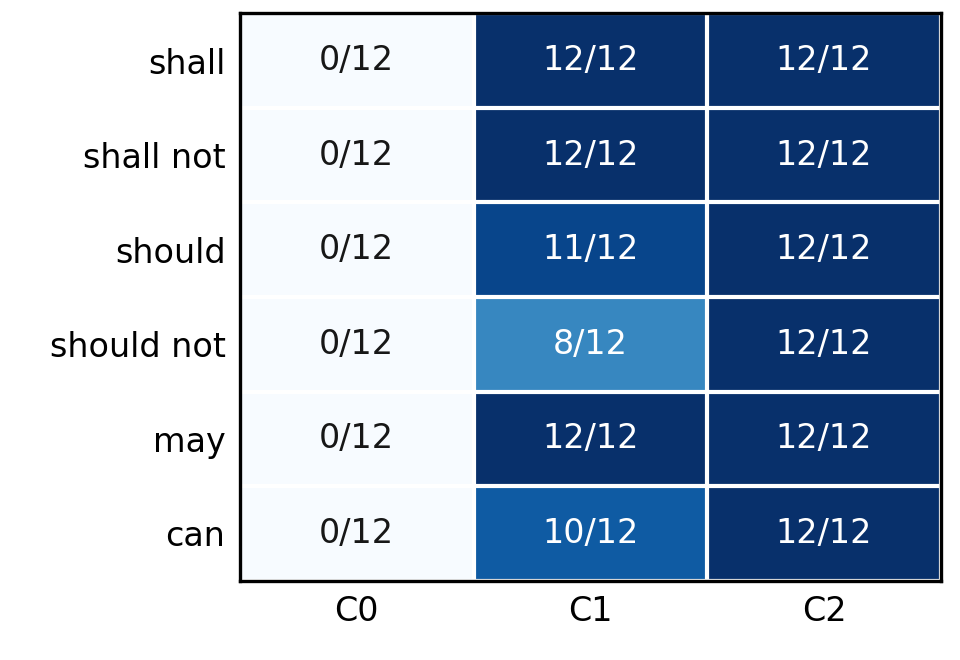

# 3GPP 요구사항의 한국어 설명에서 규범적 의미 보존을 위한 증거 제약 생성 평가

Evaluating Evidence-Constrained Generation for Preserving Normative Meaning in Korean Explanations of 3GPP Requirements

김태훈¹
¹제주대학교 통신공학과 학부생
xogns.k98@gmail.com

Taehoon Kim¹
¹Department of Telecommunications Engineering, Jeju National University

## 요약

3GPP 영문 규격을 한국어로 설명할 때 규범 강도·행위자·조건·행동·예외의 보존을 평가했다. TS 23.501과 TS 24.501 V18.12.0에서 72개 문장을 선정하고, 질문만 제공한 C0, 정답 원문을 제공한 C1, 동일 원문에 평가 gold 구조를 추가한 C2를 비교했다. Codex 기반 의미 평가에서 완전 보존은 C0 0/72, C1 65/72, C2 72/72였다. C1-C2 차이는 +9.72%p(bootstrap 95% CI +2.78~+16.67%p, exact McNemar p=0.015625)이나, 모호한 gold 3건을 제외하면 +5.80%p, p=0.125였다. 이 결과는 정답 구조 제공 조건의 관찰이며 자동 추출, 실제 검색, 독립 전문가 타당도를 입증하지 않는다.

## 서론

3GPP 기술규격은 이동통신 시스템의 구조와 프로토콜 동작을 정의한다. ETSI 작성 규칙에서 shall/shall not은 의무·금지, should/should not은 권고·비권고, may는 허용, can은 가능 또는 능력을 뜻한다[1]. may와 can은 한국어에서 모두 ‘~할 수 있다’로 표현되기 쉬우나 규범적 의미는 다르다. 행위자, 적용 조건 또는 예외까지 바뀌면 구현과 시험 판단도 달라질 수 있다.

기존 연구는 3GPP 데이터셋과 질의응답[2], 통신 규격 RAG[3], 한국어 통신 에이전트 평가[4], 교차 참조·버전 변화 검색[5], 규범 해석·보안 추론[6]을 다뤘다. 법률 번역에서도 계층적 제약으로 규범 강도를 보존하는 접근이 제안됐다[7]. 본 연구는 고정된 영문 3GPP 문장의 한국어 설명에서 규범 강도·행위자·조건·행동·예외를 분해하고, 원문 단독과 정답 구조 추가 조건을 같은 사례에서 비교한다.

본 연구 질문은 정답 원문을 제공한 생성(C1)에 비해, 원문의 규범 요소를 구조화해 함께 제공하는 생성(C2)이 한국어 설명의 완전 의미 보존율을 높이는가이다. 기여는 의미 요소별 평가 기준, 동일 oracle evidence를 공유하는 조건의 통제 비교, modal 범주별 오류 분석이다. 검색 정확도나 RAG 성능은 연구 범위에 포함하지 않는다.

## 연구 방법

실험 원문은 ETSI 공식 배포본인 3GPP TS 23.501 및 TS 24.501 V18.12.0 Release 18로 고정했다[8], [9]. 조항 4~8과 4~6에서 추출한 7,727개 후보에 사전 제외·중복 제거 규칙을 적용했다. 최종 72개 문장은 modal 6종별 12개, 규격별 36개이며 단순 8개·조건형 22개·복합형 42개다. should는 규격별 4+8개, should not은 8+4개로 사전 예외를 적용했다. 44개 조항에서 선정했으므로 같은 조항 문장 간 의존성은 남는다. 원문과 actor·modal·polarity·condition·action·exception 라벨 및 prompt를 실행 전에 해시로 동결했다.

C0는 질문과 규격 메타데이터만 받고 modal 6종 중 하나를 강제 선택한다. C1은 정답 원문과 의미 보존 지시를 제공한다. C2는 같은 원문에 평가 gold와 동일한 actor·modal·polarity·condition·action·exception을 추가한 oracle structured condition이다. 따라서 구조화 표현과 정답 해석 제공의 효과를 분리하지 못하며 자동 추출은 평가하지 않는다. 모델은 gpt-5.4-mini-2026-03-17, temperature 0, reasoning effort none, 최대 출력 600 tokens로 고정했다. seed는 요청 순서만 고정하며, 216개 요청은 첫 시도와 JSON 파싱에 모두 성공했다.

주 지표는 한국어 설명에서 적용 가능한 행위자·규범 강도와 부정·조건·행동·예외가 모두 보존되고 미지원 규범 추가가 없을 때 1인 완전 보존율이다. JSON modal 정확도는 별도 출력 필드의 정답 일치율이며 설명 판정과 구분한다. 인용 지표는 제공한 규격·버전·조항 식별자의 복사 일치율이다. 라벨 자체 검토와 의미 채점은 Codex를 이용했으며 독립 통신 전문가 검증은 수행하지 않았다. 조건·사례 ID를 가린 pass 1과 24시간 이후 재무작위 pass 2, 불일치 조정은 같은 Codex 평가자가 수행했다. 사전에 조건별 집계를 보았으므로 완전한 맹검은 아니다. 완전 보존 판정은 213/216(98.61%, κ=0.970)이 일치했으나 인간 평가자 간 신뢰도가 아니다. 비율에는 Wilson 95% CI, C1-C2 paired 차이에는 20,000회 bootstrap과 양측 exact McNemar 검정을 사용했다.

## 실험 결과

<표 1> 조건별 규범 의미 보존 결과(조건별 n=72)

| 조건 | JSON modal | 설명 완전 보존 | 미지원 추가 | 인용 ID 일치 |
|---|---:|---:|---:|---:|
| C0 | 15/72 (20.83%) | 0/72 (0.00%) | 65/72 (90.28%) | N/A |
| C1 | 56/72 (77.78%) | 65/72 (90.28%) | 7/72 (9.72%) | 72/72 (100%) |
| C2 | 72/72 (100%) | 72/72 (100%) | 0/72 (0.00%) | 72/72 (100%) |

표 1의 완전 보존은 C0 0/72, C1 65/72(90.28%), C2 72/72(100%)였다. C1-C2 차이는 +9.72%p(bootstrap 95% CI +2.78~+16.67%p), C2만 성공한 7건에 대한 exact McNemar p=0.015625였다. C2의 100%는 현 표본에서 오류가 관찰되지 않았다는 뜻이며 Wilson 95% CI는 94.93~100%다. C1의 9건은 JSON modal이 틀려도 설명은 보존으로 판정돼 두 지표가 다르다. C2는 gold modal을 입력받으므로 JSON 정확도는 독립적인 추론 능력의 증거가 아니다.

(그림 1) Modal 범주별 완전 의미 보존율(각 셀 n=12)

C1은 shall·shall not·may에서 12/12, should 11/12, should not 8/12, can 10/12였다. 동결 rubric상 실패 7건 중 4건은 should not을 강한 금지로 설명한 사례다. 나머지 3건은 평가 대상의 행위자·modal 범위가 모호해 독립 검토가 필요하다. 예를 들어 security 활성화 전 AMF·UE의 context 수립을 설명한 답변은 질문에 부합할 수 있지만, actor=security·modal=can인 동결 gold에서는 실패다.

세 모호 사례(MAIN-CAN-004, MAIN-SD-002, MAIN-CAN-008)는 1차 평가 후 발견해 지연 2차 평가 전에 기록했다. 동결 gold를 바꾸지 않고 이를 제외한 민감도 분석을 병기하면 C1 65/69(94.20%), C2 69/69(100%), 차이 +5.80%p, exact McNemar p=0.125다. 개선 방향은 유지되지만 유의성은 유지되지 않아 효과 크기는 gold 범위에 민감하다. 기존 usage에서 C2의 총 token은 C1보다 11.0% 많았으나 구조 구축·자동 추출 비용은 포함하지 않는다.

## 결론 및 한계

고정된 원문에 정답 규범 구조를 추가하면 한국어 설명의 완전 보존율이 높아지는 현상을 관찰했다. 특히 should not의 강도와 종속 표현의 범위가 주요 검토 지점이었다. 다만 모호한 3건을 제외하면 유의성이 유지되지 않아 일반적인 성능 향상으로 확대 해석할 수 없다.

본 연구는 단일 모델·두 규격의 한 버전·72개 문장·Codex 기반 라벨과 평가에 한정된다. 정답 구조 제공과 표현 형식의 효과를 분리하지 못하며, 실제 검색·자동 추출·독립 전문가 타당도는 검증하지 않았다. 후속 연구는 원문만으로 구조를 자동 추출한 뒤 설명을 생성하여 추출 오류와 설명 오류를 분리하고, 독립 검토 및 다른 모델·새 조항에서 재현하는 것이다.

참고문헌

[1] ETSI, "ETSI Drafting Rules," Clause 3.2, Verbal forms for the expression of provisions, 2026.

[2] R. Nikbakht, M. Benzaghta, and G. Geraci, "TSpec-LLM: An Open-source Dataset for LLM Understanding of 3GPP Specifications," arXiv:2406.01768, 2024.

[3] G. M. Yilma, J. A. Ayala-Romero, A. Garcia-Saavedra, and X. Costa-Perez, "TelecomRAG: Taming Telecom Standards with Retrieval Augmented Generation and LLMs," arXiv:2406.07053, 2024.

[4] S. Lee et al., "TelAgentBench: A Multi-faceted Benchmark for Evaluating LLM-based Agents in Telecommunications," Proc. EMNLP Industry Track, pp. 1173-1211, 2025.

[5] A. G. Manvattira, Y. Xu, Z. Dang, and S. Lu, "DeepSpecs: Expert-Level Question Answering in 5G," Findings of ACL, pp. 26935-26953, 2026.

[6] K. Xie, X. Zhao, Y. Hu, S. Yuan, and T. Xie, "CellularSpecSec-Bench: A Staged Benchmark for Evidence-Grounded Interpretation and Security Reasoning over 3GPP Specifications," arXiv:2601.12716, 2026.

[7] L. Meng et al., "Beyond multi-agent translation: engineering fidelity in legislative text translation via hierarchical control," Artificial Intelligence and Law, 2026, doi:10.1007/s10506-026-09529-2.

[8] ETSI, "5G; System architecture for the 5G System (5GS)," ETSI TS 123 501 V18.12.0, 3GPP TS 23.501 Release 18, 2026.

[9] ETSI, "5G; Non-Access-Stratum (NAS) protocol for 5G System (5GS); Stage 3," ETSI TS 124 501 V18.12.0, 3GPP TS 24.501 Release 18, 2025.
