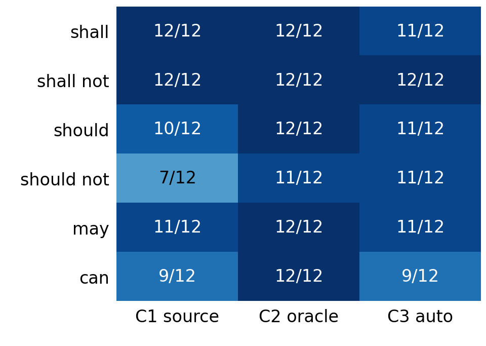

# 3GPP 요구사항의 한국어 설명에서 규범적 의미 보존을 위한 증거 제약 생성 평가

Evaluating Evidence-Constrained Generation for Preserving Normative Meaning in Korean Explanations of 3GPP Requirements

김태훈¹
¹제주대학교 통신공학과 학부생
xogns.k98@gmail.com

Taehoon Kim¹
¹Department of Telecommunications Engineering, Jeju National University

## 요약

3GPP 영문 규격의 한국어 설명에서 규범 강도·행위자·조건·행동·예외의 보존을 평가했다. TS 23.501과 TS 24.501 V18.12.0의 72개 문장에 원문 단독(C1), 정답 구조 추가(C2), 자동 추출 구조 추가(C3)를 비교했다. Codex의 새 첫 의미 검토에서 완전 보존은 각각 61/72, 71/72, 65/72였다. C3−C1 차이는 +5.56%p(bootstrap 95% CI −2.78~+13.89%p, exact McNemar p=0.34375)로 개선을 확정할 수 없다. 규범 대상 이동과 양화·예외 오류를 확인했으며 기존 평가와 9건의 판정 차이가 있었다. 결과는 독립 전문가 검증 및 지연 재검토 전의 잠정 평가다.

## 서론

3GPP 기술규격은 이동통신 시스템의 구조와 프로토콜 동작을 정의한다. ETSI 작성 규칙에서 shall/shall not은 의무·금지, should/should not은 권고·비권고, may는 허용, can은 가능 또는 능력을 뜻한다[1]. may와 can은 한국어에서 모두 ‘~할 수 있다’로 표현되기 쉬우나 규범적 의미는 다르다. 행위자, 적용 조건 또는 예외까지 바뀌면 구현과 시험 판단도 달라질 수 있다.

기존 연구는 3GPP 데이터셋과 질의응답[2], 통신 규격 RAG[3], 한국어 통신 에이전트 평가[4], 교차 참조·버전 변화 검색[5], 규범 해석·보안 추론[6]을 다뤘다. 법률 번역에서도 계층적 제약으로 규범 강도를 보존하는 접근이 제안됐다[7]. 본 연구는 고정된 3GPP 문장의 한국어 설명을 규범 요소별로 평가하고, 원문 단독·정답 구조·자동 추출 구조 조건을 비교한다.

연구 질문은 원문 단독(C1)에 정답 구조(C2) 또는 자동 추출 구조(C3)를 추가할 때 한국어 설명의 완전 의미 보존율이 어떻게 달라지는가이다. 정답 구조의 효과와 자동화 시 발생하는 오류를 구분하고, 규범 유형·행위자·조건·예외의 보존을 분석한다. 검색 정확도나 3GPP 전체에 대한 일반화는 연구 범위에 포함하지 않는다.

## 연구 방법

실험 원문은 ETSI 공식 배포본인 3GPP TS 23.501 및 TS 24.501 V18.12.0 Release 18로 고정했다[8], [9]. 조항 4~8과 4~6에서 추출한 7,727개 후보에 사전 제외·중복 제거 규칙을 적용했다. 최종 72개 문장은 modal 6종별 12개, 규격별 36개이며 단순 8개·조건형 22개·복합형 42개다. should는 규격별 4+8개, should not은 8+4개로 사전 예외를 적용했다. 44개 조항에서 선정했으므로 같은 조항 문장 간 의존성은 남는다. 원문과 actor·modal·polarity·condition·action·exception 라벨 및 prompt를 실행 전에 해시로 동결했다.

C1은 정답 원문과 의미 보존 지시를 받는다. C2는 동일 원문에 평가 gold와 같은 actor·modal·polarity·condition·action·exception을 추가한 oracle structured 조건이다. 후속 탐색 조건 C3는 원문만으로 여섯 필드를 자동 추출하고, 기존 C2 생성 prompt의 gold 구조를 추출 결과로 교체한다. 추출에는 질문·gold를 주지 않으며, 불명확한 추출은 보류한다. 생성은 동일 모델 gpt-5.4-mini-2026-03-17, temperature 0, reasoning effort none, 최대 출력 600 tokens이고 C3 추출 상한은 1,200 tokens다. C1/C2는 9월 3일, C3는 9월 6일에 생성했다. C3는 72건 추출·71건 설명 생성·1건 보류였으며 같은 표본을 사용한 후속 실험이다.

주 지표는 한국어 설명의 행위자·규범 강도와 부정·조건·행동·예외가 모두 보존되고 미지원 규범 추가가 없을 때 1인 완전 보존율이다. 조건·예외가 없는 항목은 NA로, 보류는 전체 분모의 실패로 처리한다. JSON modal과 제공된 출처 ID 복사 일치는 별도 지표다. 이번 표·그림은 C1/C2/C3 설명 216건을 새 순서로 섞은 Codex 단일 평가자의 첫 의미 검토 결과다. 행별 조건·사례 ID는 가렸으나 검토자는 기존 결과를 알고 있어 독립 맹검은 아니다. 모든 행에 근거를 기록했으며 독립 전문가 검증과 이번 평가의 지연 재검토는 미완료다. Wilson 구간, 20,000회 case paired bootstrap, 양측 exact McNemar 검정을 사용하고 조항 단위 bootstrap을 사후 보조 분석했다.

## 실험 결과

<표 1> 조건별 잠정 의미 평가 결과(첫 검토, 각 n=72)

| 조건 | JSON modal | 설명 완전 보존 | 미지원 추가 | 인용 ID 일치 |
|---|---:|---:|---:|---:|
| C1 | 56/72 (77.78%) | 61/72 (84.72%) | 9/72 (12.50%) | 72/72 (100%) |
| C2 | 72/72 (100%) | 71/72 (98.61%) | 0/72 (0.00%) | 72/72 (100%) |
| C3 | 65/72 (90.28%) | 65/72 (90.28%) | 5/72 (6.94%) | 71/72 (98.61%) |

표 1의 완전 보존은 C1 61/72, C2 71/72, C3 65/72였다. C3−C1 차이는 +5.56%p(case bootstrap 95% CI −2.78~+13.89%p, exact McNemar p=0.34375)로 개선을 확정할 수 없다. C3만 성공한 사례는 7건, C1만 성공한 사례는 3건이다. C3의 Wilson 95% CI는 81.26~95.21%다. C2는 정답 해석을 입력받으므로 높은 성능을 자동 추출 능력으로 해석하지 않는다. C3의 인용 71/72는 보류 1건을 포함한 ID 복사 결과다.

(그림 1) 첫 검토의 Modal별 완전 보존 성공 수(각 n=12)

C3에서는 실제 context 수립 필요를 수립할 능력으로 바꾸거나, UE 비사용 권고를 AMF 메시지 송신 권고에 붙이는 오류가 관찰됐다. 단순 참조를 예외로 설명한 사례도 있었다. 추출 구조에서 not all과 98% 양화가 누락돼도 JSON 라벨은 맞을 수 있었다. 슬롯 간 이동을 허용한 탐색적 구조 보존은 61/72였고, 구조 실패 11건 중 설명은 8건에서 보존됐다. 생성 단계가 원문도 받으므로 이를 추출 자체의 수정 능력으로 해석하지 않는다.

원래 모호성 3건을 제외하면 C1 59/69, C3 64/69, 차이 +7.25%p, p=0.1796875다. 같은 조항의 문장을 함께 재표집한 44-cluster bootstrap에서 C3−C1의 95% CI는 −2.53~+15.52%p로 역시 0을 포함했다. 이전 동결 평가(C1 65/72, C2 72/72)와 이번 첫 검토는 144건 중 9건의 판정이 달랐다. can과 may have the capability의 범위, 강한 한국어 표현 및 착신 용어 번역이 재검토 대상이다. 이전 점수는 보존하며 이번 수치는 잠정치로 보고한다. C3 추출·생성 143회 비용은 usage 기준 약 $0.1323이며, gold 구축과 평가 비용은 제외했다.

## 결론 및 한계

정답 구조 조건은 높은 보존율을 보였으나 자동 추출 조건의 원문 단독 대비 개선은 이번 표본에서 뚜렷하지 않았다. 추출 단계의 규범 대상·양화·부정 범위 오류와 평가 기준의 모호성이 결과에 영향을 주므로 생성 성능과 평가 불확실성을 함께 보고해야 한다.

본 연구는 단일 모델·두 규격의 한 버전·72개 문장과 Codex 기반 평가에 한정된다. 같은 평가자의 새 검토에서 판정이 달라졌고 지연 재검토·불일치 조정이 남아 있다. C2는 정답 해석 제공과 구조화 형식 효과가 섞여 있으며 C3는 후속 설계와 실행일 차이가 있다. 후속 비교는 modal 정답 힌트만 추가한 조건으로 효과를 분해하고, 규범 대상과 참조·예외 구분을 보완한 뒤 새 조항에서 검증한다.

참고문헌

[1] ETSI, "ETSI Drafting Rules," Clause 3.2, Verbal forms for the expression of provisions, 2026.

[2] R. Nikbakht, M. Benzaghta, and G. Geraci, "TSpec-LLM: An Open-source Dataset for LLM Understanding of 3GPP Specifications," arXiv:2406.01768, 2024.

[3] G. M. Yilma, J. A. Ayala-Romero, A. Garcia-Saavedra, and X. Costa-Perez, "TelecomRAG: Taming Telecom Standards with Retrieval Augmented Generation and LLMs," arXiv:2406.07053, 2024.

[4] S. Lee et al., "TelAgentBench: A Multi-faceted Benchmark for Evaluating LLM-based Agents in Telecommunications," Proc. EMNLP Industry Track, pp. 1173-1211, 2025.

[5] A. G. Manvattira, Y. Xu, Z. Dang, and S. Lu, "DeepSpecs: Expert-Level Question Answering in 5G," Findings of ACL, pp. 26935-26953, 2026.

[6] K. Xie, X. Zhao, Y. Hu, S. Yuan, and T. Xie, "CellularSpecSec-Bench: A Staged Benchmark for Evidence-Grounded Interpretation and Security Reasoning over 3GPP Specifications," arXiv:2601.12716, 2026.

[7] L. Meng et al., "Beyond multi-agent translation: engineering fidelity in legislative text translation via hierarchical control," Artificial Intelligence and Law, 2026, doi:10.1007/s10506-026-09529-2.

[8] ETSI, "5G; System architecture for the 5G System (5GS)," ETSI TS 123 501 V18.12.0, 3GPP TS 23.501 Release 18, 2026.

[9] ETSI, "5G; Non-Access-Stratum (NAS) protocol for 5G System (5GS); Stage 3," ETSI TS 124 501 V18.12.0, 3GPP TS 24.501 Release 18, 2025.
