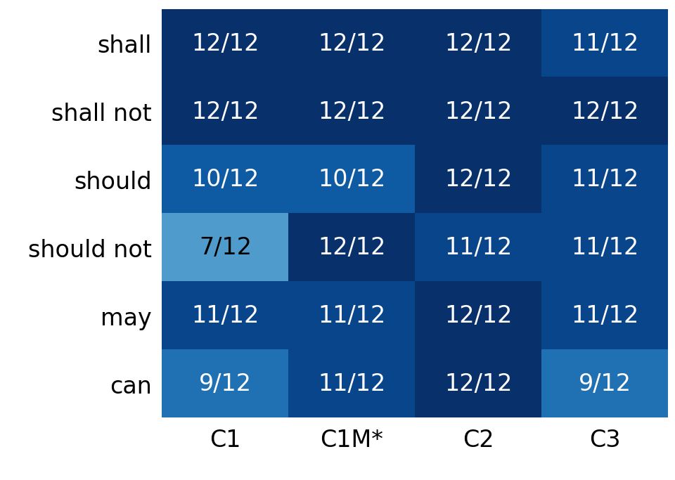

# 3GPP 요구사항의 한국어 설명에서 규범적 의미 보존을 위한 증거 제약 생성 평가

Evaluating Evidence-Constrained Generation for Preserving Normative Meaning in Korean Explanations of 3GPP Requirements

김태훈¹
¹제주대학교 통신공학과 학부생
xogns.k98@gmail.com

Taehoon Kim¹
¹Department of Telecommunications Engineering, Jeju National University

## 요약

3GPP 영문 규격의 한국어 설명에서 규범 강도·행위자·조건·행동·예외의 보존을 평가했다. TS 23.501과 TS 24.501 V18.12.0의 72개 문장에서 원문 단독(C1), 정답 구조(C2), 자동 추출 구조(C3)를 비교했다. 동일 Codex의 지연 재검토·조정 후 완전 보존은 61/72, 71/72, 65/72로 유지됐고 C3−C1 차이는 +5.56%p(p=0.34375)였다. 규범 유형·부정 정답만 추가한 C1M의 첫 평가는 68/72, C1 대비 +9.72%p(p=0.06543)였다. 자동 추출 개선이나 전체 구조와 유형 힌트의 동등성은 입증하지 못했다. 규범 대상 이동과 조건 누락이 남았으며 C1M 지연 재검토 및 독립 전문가 검증은 미완료다.

## 서론

3GPP 기술규격은 이동통신 시스템의 구조와 프로토콜 동작을 정의한다. ETSI 작성 규칙에서 shall/shall not은 의무·금지, should/should not은 권고·비권고, may는 허용, can은 가능 또는 능력을 뜻한다[1]. may와 can은 한국어에서 모두 ‘~할 수 있다’로 표현되기 쉬우나 규범적 의미는 다르다. 행위자, 적용 조건 또는 예외까지 바뀌면 구현과 시험 판단도 달라질 수 있다.

기존 연구는 3GPP 데이터셋과 질의응답[2], 통신 규격 RAG[3], 한국어 통신 에이전트 평가[4], 교차 참조·버전 변화 검색[5], 규범 해석·보안 추론[6]을 다뤘다. 법률 번역에서도 계층적 제약으로 규범 강도를 보존하는 접근이 제안됐다[7]. 본 연구는 고정된 3GPP 문장의 한국어 설명을 규범 요소별로 평가하고, 원문 단독·정답 구조·자동 추출 구조 조건을 비교한다.

연구 질문은 원문 단독(C1)에 정답 구조(C2) 또는 자동 추출 구조(C3)를 추가할 때 한국어 설명의 완전 의미 보존율이 어떻게 달라지는가이다. 후속 조건 C1M은 C1에 정답 규범 유형·부정만 추가해 정답 힌트의 영향을 살핀다. 실제 검색 정확도나 3GPP 전체 일반화는 연구 범위에 포함하지 않는다.

## 연구 방법

실험 원문은 ETSI 공식 배포본인 3GPP TS 23.501 및 TS 24.501 V18.12.0 Release 18로 고정했다[8], [9]. 조항 4~8과 4~6에서 추출한 7,727개 후보에 사전 제외·중복 제거 규칙을 적용했다. 최종 72개 문장은 modal 6종별 12개, 규격별 36개이며 단순 8개·조건형 22개·복합형 42개다. should는 규격별 4+8개, should not은 8+4개로 사전 예외를 적용했다. 44개 조항에서 선정했으므로 같은 조항 문장 간 의존성은 남는다. 원문과 actor·modal·polarity·condition·action·exception 라벨 및 prompt를 실행 전에 해시로 동결했다.

C1은 정답 원문과 의미 보존 지시를 받는다. C2는 같은 원문에 평가 gold의 actor·modal·polarity·condition·action·exception을 추가한 oracle structured 조건이다. C3는 질문·gold 없이 원문만으로 여섯 필드를 추출해 기존 C2 생성 prompt에 넣고 불명확하면 보류한다. C1M은 C1 문구를 유지하고 정답 modal·polarity만 추가한다. 생성 모델은 gpt-5.4-mini-2026-03-17, temperature 0, reasoning effort none, 출력 상한 600 tokens이며 C3 추출 상한은 1,200 tokens다. C1/C2는 9월 3일, C3/C1M은 9월 6일 생성했다. C3는 72건 추출·71건 설명·1건 보류이고 C1M은 72건 생성했다. 입력과 응답을 동결했으며 재생성하지 않았다.

주 지표는 설명의 행위자·규범 강도와 부정·조건·행동·예외가 모두 보존되고 미지원 규범 추가가 없을 때 1인 완전 보존율이다. 조건·예외가 없으면 NA, 보류는 전체 분모의 실패다. JSON modal과 출처 ID 복사 일치는 별도 지표다. C1/C2/C3 216개 설명을 Codex가 9월 6일 평가하고 24시간 후 새 순서로 재검토했다. 완전 보존 판정은 216/216, 적용 가능한 이진 판단은 1,128/1,131 일치했고 2개 응답의 세부 차이를 조정했다. C1/C2/C1M 216개도 새로 검토했으나 C1M은 첫 평가다. 행별 ID·조건을 가렸지만 기존 결과를 아는 동일 AI이므로 독립 맹검·전문가 검증이 아니다. Wilson 구간, 20,000회 case paired bootstrap과 양측 exact McNemar를 사용하고 조항 bootstrap은 사후 보조 분석했다.

## 실험 결과

<표 1> 의미 평가 결과(각 n=72, *첫 평가 잠정치)

| 조건 | JSON modal | 설명 완전 보존 | 미지원 추가 | 인용 ID 일치 |
|---|---:|---:|---:|---:|
| C1 | 56/72 (77.78%) | 61/72 (84.72%) | 9/72 (12.50%) | 72/72 (100%) |
| C1M* | 72/72 (100%) | 68/72 (94.44%) | 3/72 (4.17%) | 72/72 (100%) |
| C2 | 72/72 (100%) | 71/72 (98.61%) | 0/72 (0.00%) | 72/72 (100%) |
| C3 | 65/72 (90.28%) | 65/72 (90.28%) | 5/72 (6.94%) | 71/72 (98.61%) |

표 1에서 C1/C2/C3의 지연 조정 결과는 61/72, 71/72, 65/72다. C3−C1은 +5.56%p(case bootstrap 95% CI −2.78~+13.89%p, p=0.34375)로 개선을 확정할 수 없다. C3만 성공 7건, C1만 성공 3건이며, 44개 조항 bootstrap 구간도 −2.53~+15.52%p다. 원래 모호성 3건 제외 시 C1 59/69, C3 64/69, p=0.17969다. C3의 인용 71/72는 보류를 포함한 ID 복사 결과다.

(그림 1) Modal별 완전 보존 성공 수(각 n=12, *첫 평가)

C1M 첫 평가는 68/72로 C1 대비 +9.72%p(95% CI +1.39~+18.06%p, p=0.06543)였다. C1M만 성공 9건, C1만 성공 2건이다. 원래 모호성 3건 제외 시 67/69 대 59/69, p=0.02148로 해석이 달라진다. C2−C1M은 +4.17%p(95% CI −1.39~+11.11%p, p=0.375)이나 비유의성을 동등성으로 보지 않는다. 작은 이산 표본의 exact 검정과 bootstrap 결과를 함께 보고하며 제외 분석만으로 개선을 주장하지 않는다.

C1M의 오류 4건은 규범 대상을 접근 제한 능력 또는 DSCP 설정에 옮긴 경우, T3526 시작 원인 누락, SNPN 식별자 누락이었다. C3에는 context 실제 수립을 수립 능력으로 바꾸거나 단순 참조를 예외로 설명한 오류도 있었다. 추출의 not all·98% 누락은 JSON 라벨만으로 검출되지 않았다. 이전 동결 평가(C1 65/72, C2 72/72)와 달랐던 9건은 이번 지연 검토에서도 수정 판정이 유지됐다. may have the capability와 원문 범위 모호성은 남으며, C1M의 해석이 민감한 성공 2건을 실패로 보는 사후 분석에서는 66/72, C1 대비 p=0.22656이다.

## 결론 및 한계

정답 구조와 규범 유형 힌트 조건은 높은 보존율을 보였으나 자동 추출의 원문 단독 대비 개선은 이 표본에서 확정되지 않았다. 규범 유형 이름뿐 아니라 그것이 적용되는 주체·행동, 조건과 예외의 범위를 보존해야 한다. 단일 AI의 재검토 일치는 판단 안정성의 관찰이며 정답 타당도를 보장하지 않는다.

본 연구는 단일 모델·두 규격 한 버전·72개 문장 및 Codex 기반 라벨과 평가에 한정된다. C1M은 지연 재검토 전 잠정치다. C2와 C1M은 구조 필드 외에 원래 지시문도 달라 순수한 구조 효과를 분리하지 못하고, 후속 설계·생성일 차이도 남는다. 추출기에서 규범 구절과 대상의 연결·양화·참조 역할을 보완한 뒤 개발에 사용하지 않은 새 조항에서 검증해야 한다.

참고문헌

[1] ETSI, "ETSI Drafting Rules," Clause 3.2, Verbal forms for the expression of provisions, 2026.

[2] R. Nikbakht, M. Benzaghta, and G. Geraci, "TSpec-LLM: An Open-source Dataset for LLM Understanding of 3GPP Specifications," arXiv:2406.01768, 2024.

[3] G. M. Yilma, J. A. Ayala-Romero, A. Garcia-Saavedra, and X. Costa-Perez, "TelecomRAG: Taming Telecom Standards with Retrieval Augmented Generation and LLMs," arXiv:2406.07053, 2024.

[4] S. Lee et al., "TelAgentBench: A Multi-faceted Benchmark for Evaluating LLM-based Agents in Telecommunications," Proc. EMNLP Industry Track, pp. 1173-1211, 2025.

[5] A. G. Manvattira, Y. Xu, Z. Dang, and S. Lu, "DeepSpecs: Expert-Level Question Answering in 5G," Findings of ACL, pp. 26935-26953, 2026.

[6] K. Xie, X. Zhao, Y. Hu, S. Yuan, and T. Xie, "CellularSpecSec-Bench: A Staged Benchmark for Evidence-Grounded Interpretation and Security Reasoning over 3GPP Specifications," arXiv:2601.12716, 2026.

[7] L. Meng et al., "Beyond multi-agent translation: engineering fidelity in legislative text translation via hierarchical control," Artificial Intelligence and Law, 2026, doi:10.1007/s10506-026-09529-2.

[8] ETSI, "5G; System architecture for the 5G System (5GS)," ETSI TS 123 501 V18.12.0, 3GPP TS 23.501 Release 18, 2026.

[9] ETSI, "5G; Non-Access-Stratum (NAS) protocol for 5G System (5GS); Stage 3," ETSI TS 124 501 V18.12.0, 3GPP TS 24.501 Release 18, 2025.
