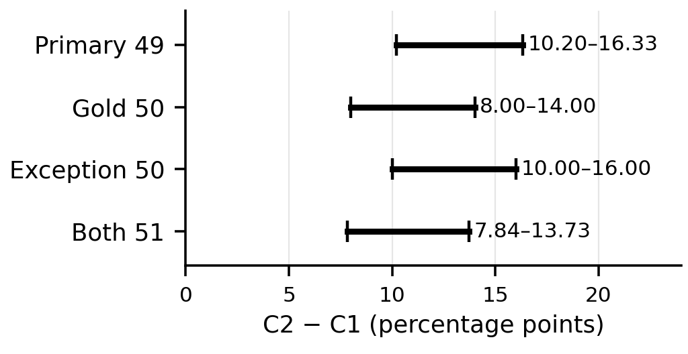

# 3GPP 요구사항의 한국어 설명에서 규범적 의미 보존을 위한 증거 제약 생성 평가

Evaluating Evidence-Constrained Generation for Preserving Normative Meaning in Korean Explanations of 3GPP Requirements

김태훈¹
¹제주대학교 통신공학과 학부생
xogns.k98@gmail.com

Taehoon Kim¹
¹Department of Telecommunications Engineering, Jeju National University

## 요약

3GPP 영문 규격의 한국어 설명에서 규범 강도·행위자·조건·행동·예외의 보존을 평가했다. 동결 응답의 사후 적격성 감사와 동일 AI의 지연 재검토 후, 주 분석 49건의 완전 보존 범위는 원문 단독 77.55~79.59%, 정답 구조 89.80~93.88%, 자동 추출 구조 83.67~87.76%, 정답 유형·부정 힌트 87.76~91.84%였다. 이는 미확정에 따른 논리적 범위이며 신뢰구간이 아니다. 별도 개발 원문 3개에서 추가 생성된 8개 설명의 지정 요구사항 재검토로 규범 강도 변경과 조건·예외 누락을 확인했다. 메타데이터가 맞아도 설명의 명제 연결이 달라질 수 있어 두 평가를 구분해야 한다. 사후 표본 처리와 단일 AI 평가의 한계가 있으며 통계적 우월성이나 일반화를 주장하지 않는다.

## 서론

3GPP 기술규격은 이동통신 시스템의 구조와 프로토콜 동작을 정의한다. ETSI 작성 규칙에서 shall/shall not은 의무·금지, should/should not은 권고·비권고, may는 허용, can은 가능 또는 능력을 뜻한다[1]. may와 can은 한국어에서 모두 ‘~할 수 있다’로 표현되기 쉬우나 규범적 의미는 다르다. 행위자, 적용 조건 또는 예외까지 바뀌면 구현과 시험 판단도 달라질 수 있다.

기존 연구는 3GPP 데이터셋·질의응답[2], 통신 규격 RAG[3], 한국어 통신 에이전트[4], 교차 참조·버전 검색[5], 규범·보안 추론[6]을 다뤘다. 법률 번역에는 계층적 제약으로 규범 강도를 보존하는 접근이 있다[7]. 본 연구는 고정 문장의 한국어 설명에서 규범 요소의 보존을 비교한다.

원문 단독(C1)에 정답 구조(C2), 자동 추출 구조(C3), 정답 규범 유형·부정 힌트(C1M)를 추가할 때 완전 의미 보존율이 어떻게 달라지는지 비교한다. 동결 응답의 사후 재평가이며 실제 검색 정확도나 3GPP 전체 일반화는 다루지 않는다.

## 연구 방법

원문은 ETSI 공식 배포본 TS 23.501 및 TS 24.501 V18.12.0 Release 18로 고정했다[8], [9]. 최초 72개 문장(규범 유형 6종별 12개, 44개 조항)은 7,727개 후보에서 선정했다. 사후 적격성 감사에서 일반 적격 50건, 조건부 예외 1건, 부적격 10건, 보류 11건을 확인했다. 부적격은 NOTE·목록 제외 위반이며, 보류는 문맥 범위·메타데이터·대응 관계·의미 중복 문제다. 사후 분석 처리 방침을 재평가 전에 동결하고, 일반 적격 중 C2 정답 입력 오염 사례(MAY-001)를 제외한 49건·33개 조항을 주 분석으로 삼았다. 기존 응답은 수정하지 않았다.

C0는 원문 없는 질문 조건이다. C1은 원문과 의미 보존 지시를, C2는 원문과 정답 actor·modal·polarity·condition·action·exception을 받는 oracle structured 조건이다. C3의 추출은 원문만 사용한다. 설명 생성은 질문·원문·자동 추출 여섯 필드를 함께 사용하며 추출이 불명확하면 보류한다. C1M은 C1에 정답 modal·polarity만 추가한다. 모델은 gpt-5.4-mini-2026-03-17, temperature 0, reasoning effort none, 출력 상한 600 tokens이며 C3 추출은 1,200 tokens다. C1/C2는 9월 3일, C3/C1M은 9월 6일 생성했다. C2와 C1M은 정답 힌트를 쓰므로 자동 추출 성능과 구분한다.

주 분석은 동결 기준에 따라 설명의 규범 요소를 모두 보존하고 미지원 규범 추가가 없으면 P, 명확한 위반은 F, 판정 미확정은 U다. 미생성 NG는 의미 오류와 구분하되 분모에 남겨 성공 0으로 센다. 합집합 51건×5조건을 동일 Codex가 9월 8일 평가하고 24시간 이상 후 재검토해 불일치 5건을 조정했다. 독립 맹검은 아니다. 확정 판정을 고정한 P/N~(P+U)/N은 U의 실패/성공 처리에 따른 논리적 범위이며 신뢰구간이 아니다. U가 남은 추론 통계는 보류했다.

## 실험 결과

<표 1> 주 분석 49건의 완전 의미 보존 결과

| 조건 | P | F | U / NG | 보존율 범위(%) |
|---|---:|---:|---:|---:|
| C0 | 0 | 49 | 0 / 0 | 0.00~0.00 |
| C1 | 38 | 10 | 1 / 0 | 77.55~79.59 |
| C2 | 44 | 3 | 2 / 0 | 89.80~93.88 |
| C3 | 41 | 5 | 2 / 1 | 83.67~87.76 |
| C1M | 43 | 4 | 2 / 0 | 87.76~91.84 |

표 1의 범위는 미확정 판정에 따른 논리적 상·하한이다. C2−C1은 +10.20~+16.33%p, C3−C1은 +4.08~+10.20%p, C1M−C1은 +8.16~+14.29%p다. 조건별 응답 U 합계 7건과 C3 미생성 1건은 분모에 남겼다. C0의 0/49는 원문 없는 조건에서 이 완전 보존 기준을 충족하지 못한 결과다.

(그림 1) 표본별 C2−C1 논리적 범위(신뢰구간 아님)

주 분석에 MAY-001을 더한 Gold 50, 조건부 예외 SDN-011을 더한 Exception 50, 둘 다 더한 Both 51을 비교했다(그림 1). 채점 정답 보정은 기존 C2 입력 오염을 제거하지 않는다. 네 표본에서 C2·C3·C1M의 C1 대비 차이 하한은 양수다. 이는 확정 판정에 조건부인 기술적 비교이며 모집단 우월성은 아니다. 중첩 표본을 독립 반복으로 보지 않는다.

C2−C1M은 주 분석에서 −2.04~+6.12%p이며 세 민감도 표본에서도 0을 포함해 순위나 동등성을 확정할 수 없다. 실제 오류로 TS 24.501 §4.4.4.2의 NAS 메시지 무결성 검사 조건을 “UE의 수신 5GMM 엔티티가 NAS에 의해 성공적으로 무결성 검사를 받은 경우”로 설명한 응답이 있었다. 금지 표현을 유지했어도 검사 대상이 메시지에서 엔티티로 바뀌어 실패로 판정했다.

개발 원문 SMF(§4.2.3)·AMF(§5.4.11.4)[8]·NSSAI(§4.6.2.2 및 Annex C)[9]에 문맥을 제공해 각 3회 직접 설명을 계획했다(9월 14일, 동일 모델, temperature 0, 2~4문장, 900토큰). 통신 미상 1개는 재시도하지 않았다. 추가 평가는 동결한 SMF 2개·NSSAI 4개·AMF 3개의 요구사항을 대상으로 한다. 선택적 능력 보유, SUPI 결합, 긴급·eCall의 비저장/임시 저장/삭제 사건, 위치 판단의 권고·위성 범위·망 설정을 확인한다. 복합 항목은 모든 요소를 보존해야 하며, 설명만 채점하고 메타데이터로 보충하지 않는다. 문맥 전체의 모든 명제를 망라한 지표는 아니다. 완료 8개는 같은 날 동일 AI의 재검토 후에도 완수 3·미완수 5였다(SMF 2/2, NSSAI 1/3, AMF 0/3).

AMF 3개에서 강도 변경과 지정된 망 설정 조건의 미보존을 확인했다. 첫 응답의 “등록해제해서는 안 된다”는 should not의 권고 한정이 없다. NSSAI 2개는 eCall 예외 일부를 누락했다. 마지막 응답의 eCall 임시 저장은 메타데이터에만 남았고, 긴급 등록 절의 임시 저장을 eCall로 자동 확장해 읽지 않았다. 반면 “저장해야 한다는 권고”는 전체 표현이 권고를 명시해 강도 오류로 세지 않았다.

## 결론 및 한계

확정 판정 아래 세 조건의 C1 대비 차이는 양수지만 C2와 C1M의 우열은 정해지지 않았다. 규범 강도·검사 대상·조건·예외 오류는 유형 및 출처 필드와 별도로 자연어 설명의 명제 연결을 평가해야 함을 보여준다.

단일 모델·고정 규격·동일 AI의 정답과 평가, 사후 표본 처리·조항 의존성·미확정 판정에 한정된다. 지시문과 생성일 차이로 순수한 구조 효과를 분리하지 못한다. 추가 진단은 알려진 원문의 반복이며 주 분석과 합산하지 않았다. 추가 재검토는 기존 판정을 아는 같은 AI가 수행했고 독립·지연 검증이 아니다. 통신 미상은 의미 오류와 구분했다. 통계적 일반화보다 독립 전문가와 새 조항 검증이 필요하다.

참고문헌

[1] ETSI, "ETSI Drafting Rules," Clause 3.2, Verbal forms for the expression of provisions, 2026.

[2] R. Nikbakht, M. Benzaghta, and G. Geraci, "TSpec-LLM: An Open-source Dataset for LLM Understanding of 3GPP Specifications," arXiv:2406.01768, 2024.

[3] G. M. Yilma, J. A. Ayala-Romero, A. Garcia-Saavedra, and X. Costa-Perez, "TelecomRAG: Taming Telecom Standards with Retrieval Augmented Generation and LLMs," arXiv:2406.07053, 2024.

[4] S. Lee et al., "TelAgentBench: A Multi-faceted Benchmark for Evaluating LLM-based Agents in Telecommunications," Proc. EMNLP Industry Track, pp. 1173-1211, 2025.

[5] A. G. Manvattira, Y. Xu, Z. Dang, and S. Lu, "DeepSpecs: Expert-Level Question Answering in 5G," Findings of ACL, pp. 26935-26953, 2026.

[6] K. Xie, X. Zhao, Y. Hu, S. Yuan, and T. Xie, "CellularSpecSec-Bench: A Staged Benchmark for Evidence-Grounded Interpretation and Security Reasoning over 3GPP Specifications," arXiv:2601.12716, 2026.

[7] L. Meng et al., "Beyond multi-agent translation: engineering fidelity in legislative text translation via hierarchical control," Artificial Intelligence and Law, 2026, doi:10.1007/s10506-026-09529-2.

[8] ETSI, "5G; System architecture for the 5G System (5GS)," ETSI TS 123 501 V18.12.0, 3GPP TS 23.501 Release 18, 2026.

[9] ETSI, "5G; Non-Access-Stratum (NAS) protocol for 5G System (5GS); Stage 3," ETSI TS 124 501 V18.12.0, 3GPP TS 24.501 Release 18, 2025.
